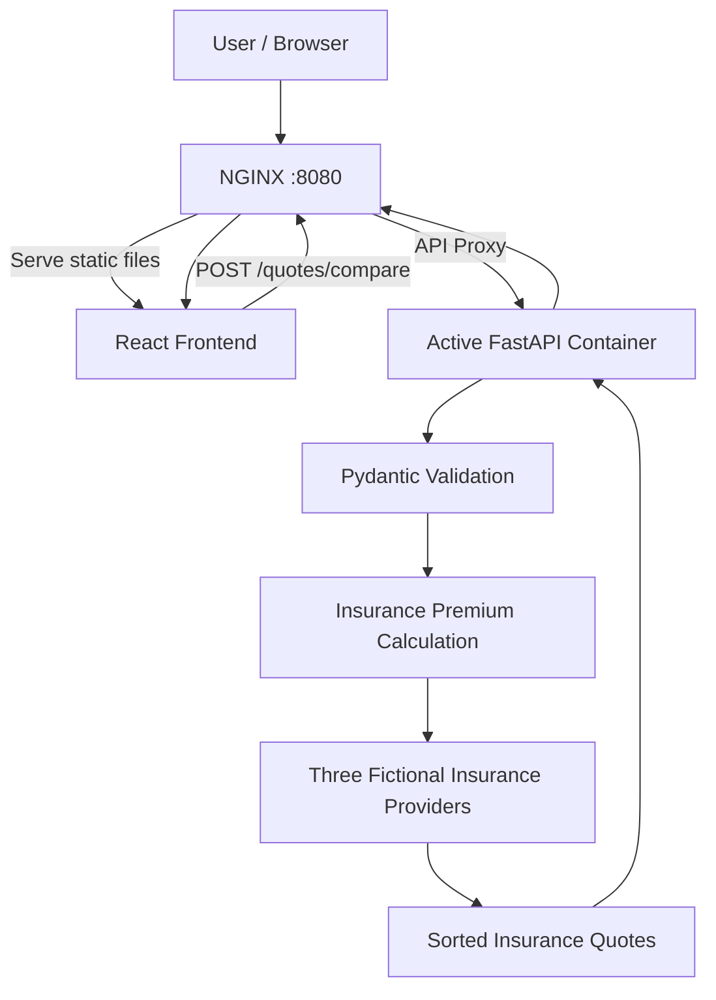
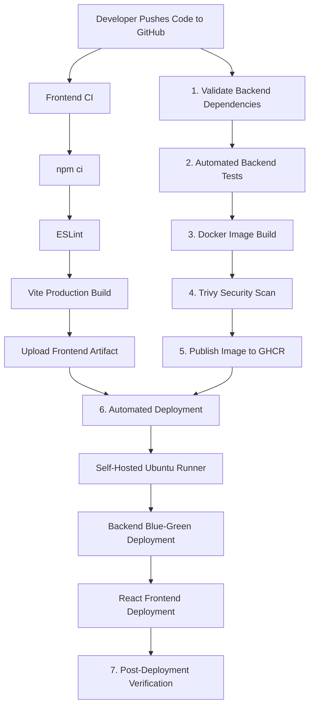
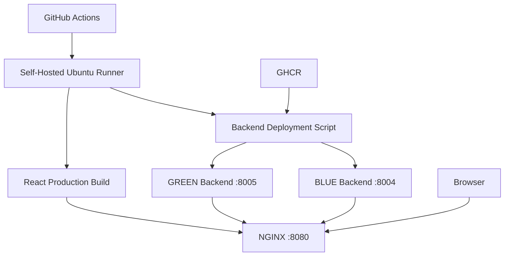
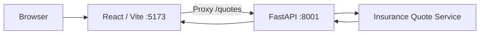

# AutoQuote — Full-Stack Insurance Comparison & DevOps CI/CD Platform

AutoQuote is a full-stack auto insurance comparison application built with **React, FastAPI, Docker, NGINX, and GitHub Actions**.

The application allows users to enter driver and vehicle information, select insurance coverage, and compare simulated premiums from three fictional insurance providers.

The project demonstrates an end-to-end DevOps workflow covering application development, automated testing, containerization, vulnerability scanning, image publishing, CI/CD, and blue-green backend deployment.

> **Disclaimer:** AutoQuote is a demonstration project. All insurance providers and premiums are simulated. The application does not retrieve real insurance quotes or issue insurance policies.

---

## 1. Project Overview

### Application Features

- Responsive React insurance comparison interface.
- FastAPI REST API.
- Driver and vehicle information validation.
- Simulated insurance premium calculations.
- Comparison of three fictional insurance providers.
- Monthly and annual premium display.
- Automatic highlighting of the lowest-priced provider.
- Backend health monitoring.

### DevOps Features

- Automated frontend linting and production builds.
- Automated Python dependency validation.
- Backend testing using Pytest.
- Docker containerization.
- Trivy container vulnerability scanning.
- Docker image publishing to GitHub Container Registry (GHCR).
- GitHub Actions CI/CD.
- Self-hosted Ubuntu deployment runner.
- Automated backend blue-green deployment.
- Automated React frontend deployment.
- NGINX reverse proxy and frontend hosting.
- Automated post-deployment verification.

### Project Status

**Status: Implemented and Successfully Validated**

The application has been tested through GitHub Actions and local browser-based testing.

| Component | Status |
|---|---|
| React frontend | Completed |
| FastAPI backend | Completed |
| Backend automated tests | Passed |
| Frontend lint and build | Passed |
| Docker image build | Passed |
| Trivy security scan | Passed |
| GHCR image publishing | Passed |
| Automated backend deployment | Passed |
| Automated frontend deployment | Passed |
| Post-deployment verification | Passed |
| Local end-to-end browser testing | Passed |

**Validated GitHub Actions execution:**

- Workflow run: `#13`
- Commit: `294c897`
- Result: All eight jobs passed
- Execution time: Approximately 2 minutes 7 seconds

---

## 2. Technology Stack

| Category | Technology | Purpose |
|---|---|---|
| Frontend | React 19 | User interface |
| Frontend Build Tool | Vite 8 | Development server and production builds |
| Frontend Language | JavaScript | Application logic |
| Frontend Code Quality | ESLint | Static code analysis |
| Backend Language | Python 3.12 | Backend development |
| Backend Framework | FastAPI | REST API |
| Data Validation | Pydantic | Request validation |
| Backend Testing | Pytest | Automated tests |
| Containerization | Docker | Backend application packaging |
| CI/CD | GitHub Actions | Automated build, test, and deployment |
| Security | Trivy | Container vulnerability scanning |
| Container Registry | GHCR | Docker image storage |
| Web Server | NGINX | Frontend hosting and reverse proxy |
| Deployment Strategy | Blue-Green | Backend release switching |
| Deployment Runner | Self-Hosted Ubuntu Runner | Deployment execution |
| Automation | Bash | Deployment scripting |
| Version Control | Git and GitHub | Source code management |

---

## 3. Application Architecture

AutoQuote consists of three main application components:

1. React frontend.
2. FastAPI backend.
3. NGINX reverse proxy for the deployed application.

### Production Architecture



### Application Request Flow

1. The user opens AutoQuote in a browser.
2. NGINX serves the React frontend.
3. The user enters driver, vehicle, and coverage information.
4. React sends an API request to `/quotes/compare`.
5. NGINX forwards the request to the active FastAPI container.
6. Pydantic validates the submitted information.
7. The backend calculates simulated insurance premiums.
8. Three quotes are returned in ascending price order.
9. React displays monthly and annual premiums.

**Production application URL on the configured deployment host:**

```text
http://127.0.0.1:8080/
```

---

## 4. CI/CD Pipeline

AutoQuote uses GitHub Actions to automate frontend and backend validation, image publishing, and deployment.

Workflow file:

```text
.github/workflows/backend-ci.yml
```

### CI/CD Architecture



### GitHub Actions Jobs

The workflow contains eight jobs.

| Job | Responsibility |
|---|---|
| Frontend | Install dependencies, lint, build React, and upload artifact |
| 1. Validate Dependencies | Install and validate Python dependencies |
| 2. Automated Tests | Execute backend tests using Pytest |
| 3. Build Docker Image | Build the backend Docker image |
| 4. Trivy Security Scan | Scan the Docker image for vulnerabilities |
| 5. Publish to GHCR | Publish the validated image |
| 6. Automated Deployment | Deploy backend and frontend |
| 7. Health Verification | Verify application health after deployment |

The frontend job runs alongside the backend validation pipeline.

Deployment waits for the required frontend artifact and published backend image.

### Frontend CI

The frontend job executes:

```bash
npm ci
npm run lint
npm run build
```

The generated `frontend/dist/` directory is uploaded as a GitHub Actions artifact.

### Backend CI

The backend pipeline performs:

1. Dependency validation.
2. Automated testing.
3. Docker image building.
4. Trivy vulnerability scanning.
5. Docker image publication.

Docker images are published using the Git commit SHA:

```text
ghcr.io/imtiaz04/autoquote-backend:<commit-sha>
```

### Automated Deployment

The deployment job executes on a configured self-hosted Ubuntu runner.

It:

1. Downloads the React production build artifact.
2. Pulls the published backend Docker image.
3. Executes the backend deployment script.
4. Performs backend blue-green switching.
5. Deploys the React production files to NGINX.

### Post-Deployment Verification

The final job verifies:

- React frontend availability.
- Backend `/healthz` response.
- Active backend deployment slot.
- Docker container health.
- Cleanup of temporary deployment containers.

**Important:** The backend uses blue-green deployment. The frontend uses direct static-file deployment.

---

## 5. Deployment Architecture

AutoQuote uses NGINX and two backend Docker containers.

### Production Port Configuration

| Component | Address / Port |
|---|---|
| NGINX | `127.0.0.1:8080` |
| BLUE Backend | `127.0.0.1:8004` |
| GREEN Backend | `127.0.0.1:8005` |
| Backend Container Internal Port | `8000` |
| React Production Files | `/var/www/autoquote/` |

### Deployment Diagram



### Blue-Green Backend Deployment

Two Docker containers provide separate backend deployment slots.

| Slot | Container | Port |
|---|---|---|
| BLUE | `autoquote-blue` | 8004 |
| GREEN | `autoquote-green` | 8005 |

Deployment script:

```text
scripts/deploy.sh
```

The deployment process:

1. Identifies the active backend slot.
2. Selects the inactive slot.
3. Pulls the new Docker image.
4. Starts the replacement container.
5. Waits for the backend health check.
6. Updates NGINX to use the new backend.
7. Validates and reloads NGINX.
8. Verifies application health.

The deployment script includes backend recovery logic for supported deployment failures.

### React Frontend Deployment

The React application is built using Vite.

GitHub Actions uploads the production build as an artifact.

During deployment, the files are copied into:

```text
/var/www/autoquote/
```

NGINX serves the React application directly.

Frontend deployment does not use blue-green switching or automatic frontend rollback.

---

## 6. Repository Structure

```text
autoquote-platform/
│
├── .github/
│   └── workflows/
│       └── backend-ci.yml
│
├── frontend/
│   ├── public/
│   ├── src/
│   │   ├── App.jsx
│   │   ├── App.css
│   │   ├── index.css
│   │   └── main.jsx
│   ├── package.json
│   ├── package-lock.json
│   └── vite.config.js
│
├── backend/
│   ├── app/
│   │   ├── main.py
│   │   ├── models/
│   │   ├── routes/
│   │   └── services/
│   ├── tests/
│   │   └── test_quotes.py
│   ├── Dockerfile
│   ├── requirements.txt
│   └── requirements-dev.txt
│
├── nginx/
│   └── autoquote.conf.example
│
├── scripts/
│   └── deploy.sh
│
├── .gitignore
└── README.md
```

---

## 7. Getting Started — Clone and Run AutoQuote Locally

This section explains how a new developer can clone and run the complete AutoQuote application on Ubuntu.

**Local development does not require Docker, NGINX, or a GitHub Actions runner.**

### Local Development Ports

| Component | Port |
|---|---|
| React / Vite Frontend | 5173 |
| FastAPI Backend | 8001 |
| Production NGINX | 8080 |
| Production BLUE Backend | 8004 |
| Production GREEN Backend | 8005 |

Only ports **5173 and 8001** are required for local development.

### Step 1 — Install Prerequisites

Required tools:

- Git
- Python 3.12
- Python virtual environment support
- Node.js 22
- npm

On Ubuntu, install Git and Python virtual environment support if they are not already installed.

Verify the required tools:

```bash
git --version
python3.12 --version
node --version
npm --version
```

All four commands should display installed versions.

If a command is unavailable, install the corresponding tool before continuing.

### Step 2 — Clone the Repository

Open a terminal and run:

```bash
git clone https://github.com/imtiaz04/autoquote-platform.git
cd autoquote-platform
```

All subsequent setup commands assume you are in the repository root unless otherwise stated.

### Step 3 — Check Port Availability

Before starting the application, check whether ports 8001 and 5173 are already in use.

```bash
sudo ss -ltnp '( sport = :8001 or sport = :5173 )'
```

If there is no output, neither port currently has a listening process.

If a port is occupied, identify the process before making changes.

To check port 8001:

```bash
sudo ss -ltnp '( sport = :8001 )'
```

To check port 5173:

```bash
sudo ss -ltnp '( sport = :5173 )'
```

Do not stop unrelated applications or Docker containers.

If port 8001 is unavailable, choose another free port and update both the FastAPI startup command and the proxy target in `frontend/vite.config.js`.

### Step 4 — Create the Python Virtual Environment

From the repository root:

```bash
python3.12 -m venv .venv
```

This creates an isolated Python environment for AutoQuote.

### Step 5 — Install Backend Dependencies

Run:

```bash
./.venv/bin/python -m pip install -r backend/requirements-dev.txt
```

This installs the dependencies required to run and test the FastAPI backend.

### Step 6 — Install Frontend Dependencies

From the repository root:

```bash
cd frontend
npm ci
cd ..
```

The frontend and backend dependencies are now installed.

### Step 7 — Start the Application

There are two ways to start AutoQuote.

#### Option A — Two Terminals (Recommended)

This is the recommended approach because frontend and backend logs remain separate.

**Terminal 1 — Start FastAPI**

From the repository root:

```bash
./.venv/bin/python -m uvicorn app.main:app \
  --app-dir backend \
  --host 127.0.0.1 \
  --port 8001
```

Expected output:

```text
INFO: Application startup complete.
INFO: Uvicorn running on http://127.0.0.1:8001
```

Keep Terminal 1 running.

**Terminal 2 — Start React**

Open a second terminal.

Navigate to the cloned repository's `frontend` directory:

```bash
cd frontend
npm run dev
```

Expected output:

```text
VITE ready
Local: http://localhost:5173/
```

Keep Terminal 2 running.

**Note:** If the second terminal opens outside the repository, navigate to the cloned repository first.

#### Option B — Start Both Applications with One Command

After completing dependency installation, you can start the frontend and backend together.

Run the following from the repository root:

```bash
bash -c '
set -e
./.venv/bin/python -m uvicorn app.main:app \
  --app-dir backend \
  --host 127.0.0.1 \
  --port 8001 &
backend_pid=$!

cleanup() {
  kill "$backend_pid" 2>/dev/null || true
  wait "$backend_pid" 2>/dev/null || true
}
trap cleanup EXIT

cd frontend
npm run dev
'
```

This command:

1. Starts FastAPI on port 8001.
2. Starts the React development server.
3. Displays application logs in the terminal.
4. Attempts to stop the background FastAPI process when the session exits.

Use **Ctrl+C** to stop the session.

This option assumes that dependencies are already installed and the required ports are available.

For troubleshooting, use Option A.

### Step 8 — Open AutoQuote

Open the frontend in your browser:

```text
http://localhost:5173/
```

You should see the AutoQuote insurance comparison interface.

Enter driver and vehicle details, select a coverage type, and click **Compare Quotes**.

The application should display three simulated insurance quotes.

### Step 9 — Verify Backend Health

Open another terminal.

Run:

```bash
curl http://127.0.0.1:8001/healthz
```

Expected response:

```json
{
  "status": "healthy"
}
```

### Step 10 — Test the Insurance Comparison API

Run:

```bash
curl -X POST http://127.0.0.1:8001/quotes/compare \
  -H "Content-Type: application/json" \
  -d '{
    "driver_age": 25,
    "zip_code": "08830",
    "vehicle_year": 2022,
    "vehicle_make": "Toyota",
    "vehicle_model": "Camry",
    "coverage_type": "full"
  }'
```

Expected result:

The API returns three simulated insurance quotes in JSON format.

### Step 11 — Verify the React Application

Open:

```text
http://localhost:5173/
```

Test with the following example:

| Field | Example |
|---|---|
| Driver Age | 25 |
| ZIP Code | 08830 |
| Vehicle Year | 2022 |
| Vehicle Make | Toyota |
| Vehicle Model | Camry |
| Coverage Type | Full Coverage |

Click **Compare Quotes**.

Expected results:

| Provider | Monthly Premium | Annual Premium |
|---|---:|---:|
| Demo Insurer C | $180 | $2,160 |
| Demo Insurer A | $200 | $2,400 |
| Demo Insurer B | $230 | $2,760 |

The lowest-priced provider should be highlighted.

These results were verified during local browser-based testing.

### Local Development Architecture



### Vite API Proxy Configuration

The development proxy is configured in:

```text
frontend/vite.config.js
```

Configuration:

```javascript
import react from '@vitejs/plugin-react'
import { defineConfig } from 'vite'

export default defineConfig({
  plugins: [react()],

  server: {
    proxy: {
      '/quotes': {
        target: 'http://127.0.0.1:8001',
        changeOrigin: true,
      },
    },
  },
})
```

The proxy forwards frontend requests beginning with `/quotes` to FastAPI on port 8001.

This allows React and FastAPI to communicate locally without NGINX.

### Stopping the Application

If using two terminals:

- Press `Ctrl+C` in the React terminal.
- Press `Ctrl+C` in the FastAPI terminal.

If using the single-command method, press `Ctrl+C` to stop the development session.

---

## 8. Insurance Comparison API

### Available Endpoints

| Method | Endpoint | Description |
|---|---|---|
| GET | `/` | Application information |
| GET | `/healthz` | Backend health check |
| POST | `/quotes/compare` | Simulated insurance comparison |

### Example Request

```http
POST /quotes/compare
```

```json
{
  "driver_age": 25,
  "zip_code": "08830",
  "vehicle_year": 2022,
  "vehicle_make": "Toyota",
  "vehicle_model": "Camry",
  "coverage_type": "full"
}
```

### Example Response

```json
{
  "quote_type": "simulated",
  "currency": "USD",
  "quotes": [
    {
      "provider": "Demo Insurer C",
      "monthly_premium": 180.0,
      "annual_premium": 2160.0
    },
    {
      "provider": "Demo Insurer A",
      "monthly_premium": 200.0,
      "annual_premium": 2400.0
    },
    {
      "provider": "Demo Insurer B",
      "monthly_premium": 230.0,
      "annual_premium": 2760.0
    }
  ]
}
```

### Request Validation

The backend validates:

- Driver age.
- ZIP code.
- Vehicle year.
- Vehicle make.
- Vehicle model.
- Coverage type.

Supported coverage types:

```text
liability
full
```

Invalid requests return HTTP 422.

All premiums use simulated pricing rules.

---

## 9. Automated Testing

### Backend Tests

AutoQuote uses Pytest.

From the repository root:

```bash
./.venv/bin/python -m pytest -v backend/tests
```

The tests cover:

- Successful insurance quote generation.
- Request validation.
- Premium calculations.
- Quote ordering.
- Invalid input handling.

### Frontend Validation

From the repository root:

```bash
cd frontend
npm ci
npm run lint
npm run build
```

The production build is generated in:

```text
frontend/dist/
```

---

## 10. Run the Backend with Docker

Docker can run the FastAPI backend independently.

Docker is optional for local development but required for the production-style deployment workflow.

### Build the Docker Image

From the repository root:

```bash
docker build -t autoquote-backend:local ./backend
```

### Start the Container

```bash
docker run --rm \
  --name autoquote-local \
  -p 127.0.0.1:8001:8000 \
  autoquote-backend:local
```

Port mapping:

| Location | Port |
|---|---|
| Host | 8001 |
| Container | 8000 |

**Important:** Stop any locally running FastAPI process on port 8001 before starting this container.

### Verify the Docker Container

```bash
curl http://127.0.0.1:8001/healthz
```

Expected response:

```json
{
  "status": "healthy"
}
```

---

## 11. Reproducing the CI/CD Deployment

The application can be run locally using React and FastAPI.

Reproducing the automated deployment requires additional infrastructure configuration.

### Deployment Prerequisites

- Ubuntu Linux deployment host.
- Docker Engine.
- NGINX.
- GitHub Actions self-hosted runner.
- GitHub repository with Actions enabled.
- Access to the configured GHCR container image.
- Required Docker and NGINX permissions.
- Frontend deployment directory.

### Self-Hosted Runner

The deployment workflow uses a runner with these labels:

```yaml
runs-on:
  - self-hosted
  - Linux
  - X64
  - autoquote-deploy
```

The runner must be registered with the repository and configured with the necessary deployment permissions.

### NGINX Configuration

The repository includes:

```text
nginx/autoquote.conf.example
```

Create a local configuration:

```bash
cp nginx/autoquote.conf.example nginx/autoquote.conf
```

Review and adapt the configuration for the deployment environment.

NGINX is responsible for:

- Serving the React frontend.
- Forwarding API requests to FastAPI.
- Routing backend traffic to BLUE or GREEN.
- Exposing the application through port 8080.

The configuration must be installed or linked into the appropriate NGINX site configuration directory for the target host.

### Environment-Specific Settings

Before reproducing automated deployment, review:

- GitHub repository and GHCR image names.
- Self-hosted runner registration and labels.
- Docker permissions.
- NGINX configuration paths.
- Deployment script paths.
- Frontend destination directory.
- NGINX reload permissions.

The current deployment was validated on a configured Ubuntu laptop.

**Important:** The GitHub Actions workflow automates application deployment after the deployment host has been configured.

The project does not automatically provision a new machine, install Docker or NGINX, or register a self-hosted runner.

Those infrastructure prerequisites must be configured separately.

---

## 12. Deployment Verification

After automated deployment, verify the application through NGINX.

### Verify the React Frontend

Open:

```text
http://127.0.0.1:8080/
```

Confirm that the React insurance comparison interface loads.

### Verify Backend Health

Run:

```bash
curl -i http://127.0.0.1:8080/healthz
```

Expected response includes:

```text
HTTP/1.1 200 OK
X-Active-Slot: blue
```

The active slot may be `blue` or `green`.

Expected response body:

```json
{
  "status": "healthy"
}
```

### Verify Docker Containers

```bash
docker ps \
  --filter "name=autoquote-blue" \
  --filter "name=autoquote-green" \
  --format "table {{.Names}}\t{{.Status}}\t{{.Ports}}"
```

Both backend containers should be healthy after a successful deployment.

### Verify Insurance Comparison

Open the deployed React application and submit valid driver and vehicle information.

Confirm that:

1. The API request completes.
2. Three simulated insurance providers appear.
3. Monthly and annual premiums are displayed.
4. The lowest-priced provider is highlighted.

---

## 13. Troubleshooting

### Port Already in Use

Check the required local development ports:

```bash
sudo ss -ltnp '( sport = :8001 or sport = :5173 )'
```

Identify the process using the occupied port before making changes.

Do not stop unrelated applications.

### FastAPI Does Not Start

Verify the Python environment:

```bash
./.venv/bin/python --version
```

If `.venv` does not exist, create it:

```bash
python3.12 -m venv .venv
```

Install dependencies:

```bash
./.venv/bin/python -m pip install -r backend/requirements-dev.txt
```

### React Does Not Start

Verify Node.js and npm:

```bash
node --version
npm --version
```

Install frontend dependencies:

```bash
cd frontend
npm ci
```

Start React:

```bash
npm run dev
```

### React Loads but Insurance Quotes Fail

Check that FastAPI is running:

```bash
curl http://127.0.0.1:8001/healthz
```

Verify the Vite proxy target in:

```text
frontend/vite.config.js
```

The target should match the FastAPI development port:

```text
http://127.0.0.1:8001
```

Restart the Vite development server after changing its configuration.

### HTTP 422 Error

HTTP 422 indicates that the submitted request failed validation.

Verify the required fields and supported coverage types.

### GitHub Actions Deployment Does Not Start

Check:

- Self-hosted runner availability.
- Runner labels.
- Required workflow dependencies.
- Docker access.
- NGINX permissions.
- GHCR image availability.

The deployment job requires a correctly configured self-hosted runner.

---

## 14. Security Practices

### Container Vulnerability Scanning

Trivy scans backend Docker images before publication.

The configured policy checks HIGH and CRITICAL severity vulnerabilities while ignoring unfixed findings.

Passing the scan means the image meets the configured policy, not that it is guaranteed vulnerability-free.

### Non-Root Backend Container

The backend Docker image is configured to execute the application using a non-root user.

### GitHub Actions Permissions

Workflow permissions are configured for the required repository and container registry operations.

### Deployment Health Checks

The deployment process validates backend health before switching traffic.

### Configuration and Credentials

Environment-specific configuration should be reviewed before deployment.

Credentials, tokens, and other secrets must not be committed to Git.

---

## 15. Current Limitations

AutoQuote is a demonstration and DevOps portfolio project.

Current limitations include:

- Insurance providers and premiums are simulated.
- No integration with real insurance company APIs.
- No persistent insurance quote database.
- No user authentication.
- Simplified premium calculation rules.
- Automated deployment requires a configured Ubuntu host.
- Frontend deployment uses direct file copying.
- Backend rollback does not provide automatic frontend rollback.

These limitations define the current project scope.

---

## 16. Author

Developed as a hands-on **Full-Stack Application and DevOps Engineering Portfolio Project**.

GitHub: **imtiaz04**

---

## 17. License

No license has been selected for this repository.

Until a license is added, the repository should not be assumed to grant permission for unrestricted redistribution or modification.

---

**AutoQuote demonstrates full-stack application development integrated with automated testing, Docker, container security scanning, GitHub Actions CI/CD, NGINX, and blue-green backend deployment.**