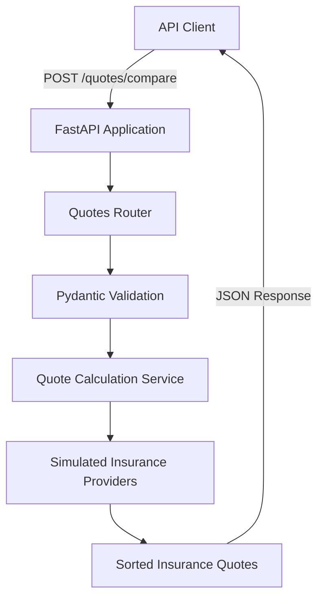
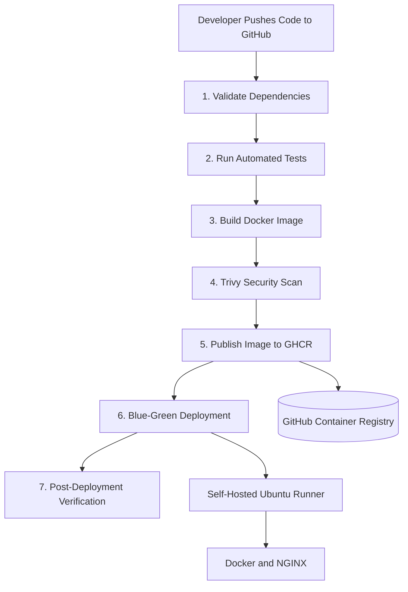
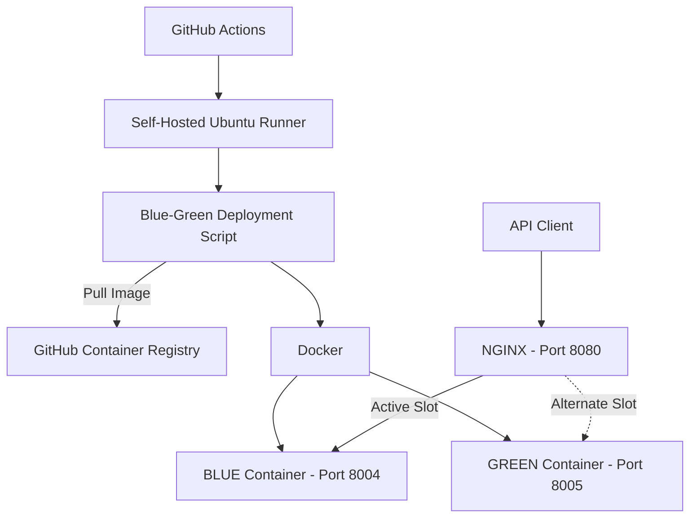

# AutoQuote — Insurance Comparison API & DevOps CI/CD Platform

**A containerized insurance comparison REST API with automated testing, security scanning, GitHub Actions CI/CD, and blue-green deployment.**

AutoQuote is a software engineering and DevOps portfolio project demonstrating the complete lifecycle of a backend application: development, testing, containerization, security scanning, image publishing, automated deployment, and post-deployment verification.

The application compares simulated auto insurance premiums from three fictional providers using driver, vehicle, and coverage information.

The deployment platform uses Docker, GitHub Actions, GitHub Container Registry (GHCR), NGINX, and a self-hosted Ubuntu runner.

> **Disclaimer:** AutoQuote uses simulated insurance data and fictional providers. It does not retrieve real insurance premiums, issue policies, or provide binding insurance quotes.

---

## Project Status

**Status: Working Application and Automated CI/CD Deployment**

The following capabilities have been implemented and successfully validated:

- FastAPI insurance comparison endpoint.
- Pydantic request validation.
- Automated backend tests using Pytest.
- Docker image building.
- Trivy container vulnerability scanning.
- Docker image publishing to GHCR.
- Automated blue-green deployment.
- NGINX reverse proxy and traffic switching.
- Post-deployment health verification.
- Deployment rollback logic.

**CI/CD milestone:** All seven GitHub Actions jobs successfully completed during the initial automated deployment test.

**Deployment milestone:** NGINX successfully switched traffic from GREEN to BLUE, and both containers passed health checks.

---

## Technology Stack

| Category | Technology |
|---|---|
| Programming Language | Python |
| Backend Framework | FastAPI |
| Request Validation | Pydantic |
| Testing | Pytest |
| Containerization | Docker |
| CI/CD | GitHub Actions |
| Security Scanning | Trivy |
| Container Registry | GitHub Container Registry |
| Reverse Proxy | NGINX |
| Deployment Strategy | Blue-Green |
| Automation | Bash |
| Deployment Environment | Ubuntu Linux |
| Source Control | Git and GitHub |

---

## Key Features

### Insurance Comparison API

- REST API built with FastAPI.
- Request validation using Pydantic.
- Simulated insurance premium calculations.
- Three fictional insurance providers.
- Monthly and annual premium comparisons.
- Results sorted by monthly premium.
- Automatic rejection of invalid request data.
- Health-check endpoint.

### DevOps and Deployment

- Seven-stage GitHub Actions CI/CD pipeline.
- Automated dependency validation and testing.
- Docker image creation and verification.
- Container vulnerability scanning using Trivy.
- Image publication to GHCR.
- Self-hosted GitHub Actions deployment runner.
- Automated blue-green deployment.
- NGINX traffic switching.
- Health checks and rollback handling.
- Post-deployment verification.

---

# 1. System Architecture

AutoQuote consists of two main components:

1. **Insurance Comparison Application**
2. **Automated CI/CD and Deployment Platform**

## Application Architecture



### Application Components

**FastAPI Application**

Handles incoming HTTP requests and exposes API endpoints.

**Quotes Router**

Defines the insurance comparison endpoint and forwards validated requests to the quote calculation service.

**Pydantic Models**

Validate driver information, ZIP codes, vehicle details, and coverage types.

**Quote Calculation Service**

Calculates simulated monthly and annual premiums.

**Insurance Providers**

Three fictional providers use different pricing multipliers to generate comparison results.

---

# 2. CI/CD Architecture

AutoQuote uses GitHub Actions to automate the software delivery process.



The workflow is defined in:

`.github/workflows/backend-ci.yml`

## Seven CI/CD Jobs

| Stage | Job | Responsibility |
|---|---|---|
| 1 | Validate | Verify Python dependencies |
| 2 | Test | Execute automated backend tests |
| 3 | Build | Build and verify Docker image |
| 4 | Security | Scan image using Trivy |
| 5 | Publish | Push verified image to GHCR |
| 6 | Deploy | Perform automated blue-green deployment |
| 7 | Verify | Validate application health and deployment |

### Stage 1 — Dependency Validation

The pipeline installs the backend development dependencies and checks for dependency conflicts.

### Stage 2 — Automated Testing

Pytest executes tests for successful insurance comparisons and invalid request handling.

If tests fail, subsequent pipeline jobs do not execute.

### Stage 3 — Docker Image Build

The application is packaged into a Docker image.

The pipeline also verifies that the image uses a non-root execution user.

The built image is saved as a workflow artifact for subsequent jobs.

### Stage 4 — Security Scanning

Trivy scans the Docker image for operating-system and application-library vulnerabilities.

The configured policy checks HIGH and CRITICAL severity vulnerabilities and ignores unfixed findings.

A security scan passing means the image meets the configured scan policy, not that it is guaranteed vulnerability-free.

### Stage 5 — Image Publishing

After successful testing and security scanning, the Docker image is published to GitHub Container Registry.

Images are tagged using the Git commit SHA.

Example image format:

```text
ghcr.io/imtiaz04/autoquote-backend:<commit-sha>
```

### Stage 6 — Automated Deployment

The self-hosted GitHub Actions runner executes the blue-green deployment script.

The deployment process pulls the required Docker image, starts the replacement container, checks its health, and updates NGINX routing.

### Stage 7 — Post-Deployment Verification

The final job verifies:

- NGINX responds successfully.
- The application health endpoint returns HTTP 200.
- The active deployment slot is identified.
- Both BLUE and GREEN containers are healthy.
- Temporary deployment backup containers have been cleaned up.

---

# 3. Blue-Green Deployment Architecture

AutoQuote uses a blue-green deployment strategy to reduce disruption during application updates.

Two application containers run on separate local ports.

| Deployment Slot | Port |
|---|---|
| BLUE | 8004 |
| GREEN | 8005 |
| NGINX Reverse Proxy | 8080 |

## Deployment Diagram



The diagram illustrates a deployment where BLUE is active. The active slot can change during subsequent deployments.

## How Blue-Green Deployment Works

1. Identify the currently active deployment slot.
2. Pull the new Docker image from GHCR.
3. Prepare the inactive deployment slot.
4. Start the new application container.
5. Wait for the container health check to pass.
6. Update NGINX to route traffic to the new container.
7. Validate and reload NGINX.
8. Verify application health through NGINX.
9. Remove temporary deployment backup containers after success.

If a deployment fails during the supported recovery stages, the deployment script attempts to restore the previous working configuration.

### Example Deployment Transition

**Before deployment:**

```text
NGINX :8080
    |
    v
GREEN :8005  ← Active
BLUE  :8004  ← Standby
```

**After successful deployment:**

```text
NGINX :8080
    |
    v
BLUE  :8004  ← Active
GREEN :8005  ← Standby
```

The application health endpoint is used to verify the deployment before and after traffic switching.

---

# 4. Insurance Comparison API

## Available Endpoints

| Method | Endpoint | Description |
|---|---|---|
| GET | `/` | Welcome message |
| GET | `/healthz` | Application health check |
| POST | `/quotes/compare` | Compare simulated insurance quotes |

## Compare Insurance Quotes

**Endpoint**

```http
POST /quotes/compare
```

### Example Request

```json
{
  "driver_age": 30,
  "zip_code": "08830",
  "vehicle_year": 2022,
  "vehicle_make": "Toyota",
  "vehicle_model": "Camry",
  "coverage_type": "full"
}
```

### Example Response

```json
{
  "quote_type": "simulated",
  "currency": "USD",
  "quotes": [
    {
      "provider": "Demo Insurer C",
      "monthly_premium": 180.0,
      "annual_premium": 2160.0
    },
    {
      "provider": "Demo Insurer A",
      "monthly_premium": 200.0,
      "annual_premium": 2400.0
    },
    {
      "provider": "Demo Insurer B",
      "monthly_premium": 230.0,
      "annual_premium": 2760.0
    }
  ]
}
```

The example represents the simulated calculation for the specified request in 2026.

## Request Validation

| Field | Validation |
|---|---|
| `driver_age` | 18–100 |
| `zip_code` | Five-digit US ZIP code |
| `vehicle_year` | 1980 through next calendar year |
| `vehicle_make` | Non-empty string |
| `vehicle_model` | Non-empty string |
| `coverage_type` | `liability` or `full` |

Invalid requests return HTTP 422.

---

# 5. Insurance Premium Calculation

AutoQuote uses a simplified premium calculation model for demonstration purposes.

### Base Monthly Premium

```text
$100
```

### Pricing Adjustments

| Condition | Adjustment |
|---|---:|
| Driver younger than 25 | +$50 |
| Vehicle less than five years old | +$30 |
| Full coverage | +$70 |

### Provider Multipliers

| Provider | Multiplier |
|---|---:|
| Demo Insurer A | 1.00 |
| Demo Insurer B | 1.15 |
| Demo Insurer C | 0.90 |

### Calculation

```text
Adjusted Base Premium
        |
        v
Apply Provider Multiplier
        |
        v
Monthly Premium
        |
        v
Multiply by 12
        |
        v
Annual Premium
```

Quotes are returned in ascending order of monthly premium.

This calculation is a simulation and should not be interpreted as a real insurance pricing model.

---

# 6. Run AutoQuote Locally

Developers can run the application without configuring the full CI/CD deployment environment.

## Prerequisites

- Git
- Python 3.12
- pip
- Docker (optional for local Python development)

## Step 1 — Clone the Repository

```bash
git clone https://github.com/imtiaz04/autoquote-platform.git

cd autoquote-platform
```

## Step 2 — Create a Python Virtual Environment

```bash
python3.12 -m venv .venv

source .venv/bin/activate
```

## Step 3 — Install Dependencies

```bash
python -m pip install --upgrade pip

python -m pip install -r backend/requirements-dev.txt
```

## Step 4 — Run Tests

```bash
cd backend

python -m pytest -v
```

## Step 5 — Start the API

From the `backend` directory:

```bash
python -m uvicorn app.main:app --host 127.0.0.1 --port 8000
```

Open the interactive API documentation:

`http://127.0.0.1:8000/docs`

### Test the Health Endpoint

```bash
curl http://127.0.0.1:8000/healthz
```

Expected response:

```json
{
  "status": "healthy"
}
```

---

# 7. Run AutoQuote Using Docker

Docker provides a consistent environment for running the backend.

## Build the Image

From the repository root:

```bash
docker build -t autoquote-backend:local ./backend
```

## Run the Container

```bash
docker run --rm \
  --name autoquote-local \
  -p 127.0.0.1:8000:8000 \
  autoquote-backend:local
```

## Verify the Application

In another terminal:

```bash
curl http://127.0.0.1:8000/healthz
```

Expected response:

```json
{
  "status": "healthy"
}
```

The API documentation is available at:

`http://127.0.0.1:8000/docs`

---

# 8. Automated Testing

The project includes automated tests using Pytest and FastAPI's TestClient.

### Current Test Coverage

| Test | Purpose |
|---|---|
| `test_compare_quotes_success` | Verify successful quote comparison |
| `test_invalid_driver_age` | Reject driver ages below the minimum |
| `test_invalid_zip_code` | Reject invalid ZIP codes |
| `test_invalid_coverage_type` | Reject unsupported coverage types |

The successful comparison test also checks the number of returned quotes, provider ordering, and expected simulated monthly premiums.

Tests run automatically in the CI/CD pipeline.

---

# 9. Repository Structure

```text
autoquote-platform/
│
├── .github/
│   └── workflows/
│       └── backend-ci.yml
│
├── backend/
│   ├── app/
│   │   ├── main.py
│   │   ├── routes/
│   │   │   └── quotes.py
│   │   ├── models/
│   │   │   └── quote.py
│   │   └── services/
│   │       └── quote_service.py
│   │
│   ├── tests/
│   │   └── test_quotes.py
│   │
│   ├── Dockerfile
│   ├── requirements.txt
│   └── requirements-dev.txt
│
├── nginx/
│   └── autoquote.conf.example
│
├── scripts/
│   └── deploy.sh
│
├── .gitignore
└── README.md
```

The repository separates application code, automated tests, CI/CD configuration, and deployment automation.

---

# 10. Security Practices

AutoQuote incorporates several security practices into its delivery workflow.

### Automated Security Scanning

Trivy scans Docker images before publication.

The configured policy focuses on HIGH and CRITICAL vulnerabilities while ignoring unfixed findings.

### Non-Root Container Execution

The CI pipeline verifies that the application container runs using a non-root user.

### GitHub Actions Permissions

The workflow grants permissions according to job requirements, including package publication.

### Deployment Verification

The deployment pipeline checks application health before and after switching traffic.

### Configuration Management

The live NGINX configuration is excluded from Git.

A reusable template is included:

```text
nginx/autoquote.conf.example
```

Sensitive credentials and tokens should never be committed to the repository.

---

# 11. Reproducing the CI/CD Deployment

The application can be run locally using Python or Docker.

Reproducing the complete automated blue-green deployment requires additional infrastructure configuration.

### Required Components

1. Ubuntu Linux deployment host.
2. Docker Engine.
3. NGINX.
4. GitHub Actions self-hosted runner.
5. GitHub repository with the workflow enabled.
6. Access to the configured container registry.
7. Appropriate runner permissions for Docker and NGINX.
8. Local NGINX configuration based on the provided example.

### Important Configuration Details

The current deployment workflow was tested on a specific Ubuntu laptop.

A developer reproducing the environment must review and adapt:

- GitHub repository ownership.
- GHCR image naming.
- Self-hosted runner registration.
- Runner labels.
- Deployment paths.
- Docker permissions.
- NGINX configuration and reload permissions.

The current setup is a working reference implementation, not a fully automated installer for arbitrary machines.

### NGINX Configuration

The repository includes:

```text
nginx/autoquote.conf.example
```

Create a local working configuration:

```bash
cp nginx/autoquote.conf.example nginx/autoquote.conf
```

The local configuration is intentionally ignored by Git.

The deployment script updates the active backend routing when switching between BLUE and GREEN.

**Do not enable automated deployment on a new machine until its runner permissions, NGINX configuration, and deployment paths have been validated.**

---

# 12. Deployment Verification

After a successful deployment, verify the application through NGINX.

```bash
curl -i http://127.0.0.1:8080/healthz
```

Expected response includes:

```text
HTTP/1.1 200 OK
X-Active-Slot: blue
```

Or:

```text
HTTP/1.1 200 OK
X-Active-Slot: green
```

Response body:

```json
{
  "status": "healthy"
}
```

### Check Docker Containers

```bash
docker ps \
  --filter "name=autoquote-blue" \
  --filter "name=autoquote-green" \
  --format "table {{.Names}}\t{{.Status}}\t{{.Ports}}"
```

Both deployment containers should report healthy after a successful deployment.

---

# 13. Current Limitations

AutoQuote is designed as a backend engineering and DevOps demonstration.

Current limitations include:

- Insurance data is simulated.
- Insurance providers are fictional.
- No integration with real insurance company APIs.
- No persistent quote database.
- No user authentication.
- No frontend interface.
- Pricing rules are simplified demonstration logic.
- Automated deployment requires a configured self-hosted runner.

These limitations define the current project scope rather than features that have already been implemented.

---

# 14. Future Improvements

Potential future enhancements include:

- Build a frontend for insurance quote comparison.
- Add a database for storing quote requests and results.
- Expand automated testing.
- Add configurable insurance pricing rules.
- Introduce application metrics and monitoring.
- Add deployment notifications.
- Improve deployment portability.
- Add configurable environment settings.
- Document disaster recovery and rollback testing.
- Explore authorized insurance provider integrations.

---

# 15. Author

Developed as a hands-on **Backend Engineering and DevOps Portfolio Project**.

GitHub: [imtiaz04](https://github.com/imtiaz04)

---

# 16. License

A license has not yet been selected.

Until a license is added, the repository should not be assumed to grant permission for unrestricted redistribution or modification.

---

**AutoQuote demonstrates the integration of backend development, automated testing, container security, CI/CD automation, and blue-green deployment in a single portfolio project.**