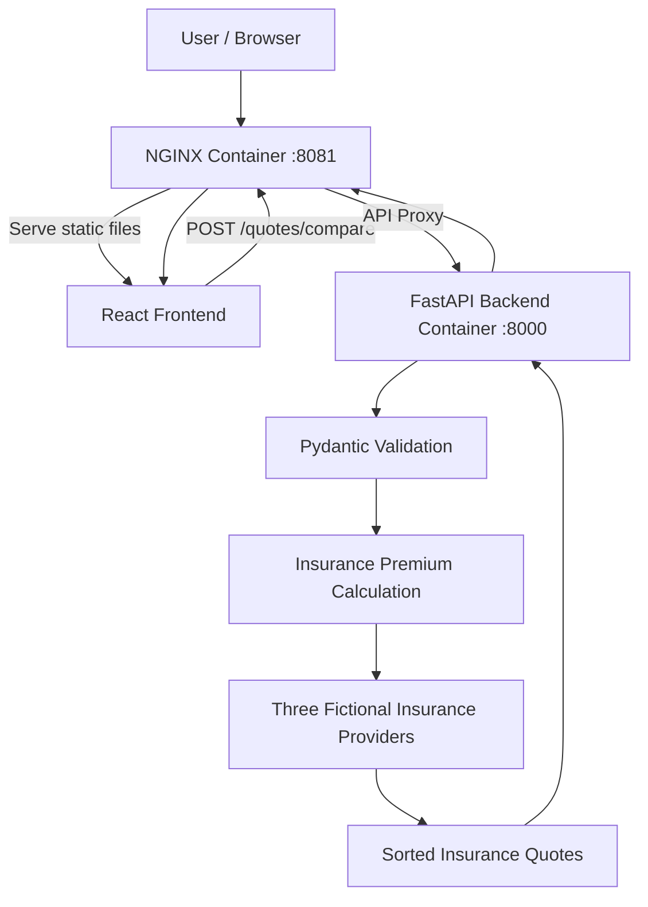
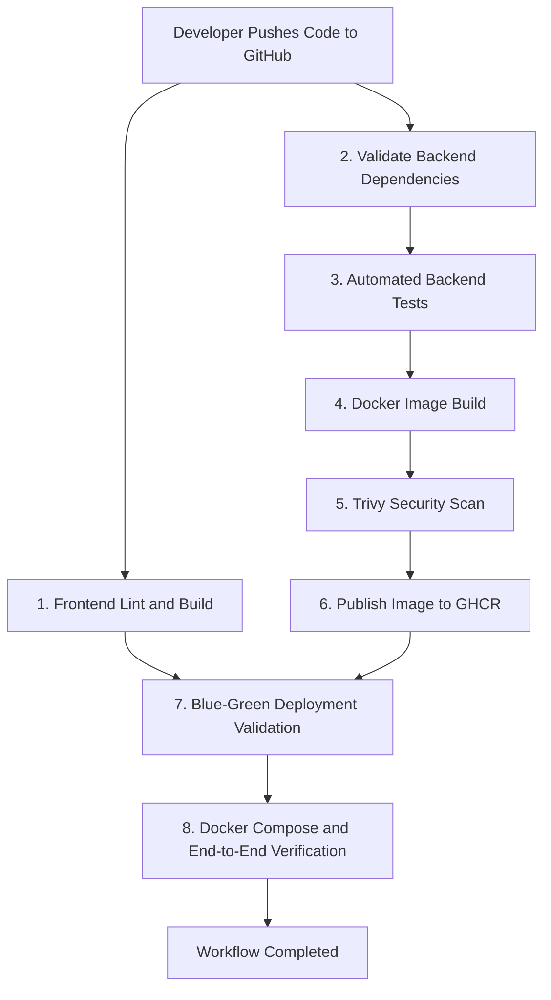
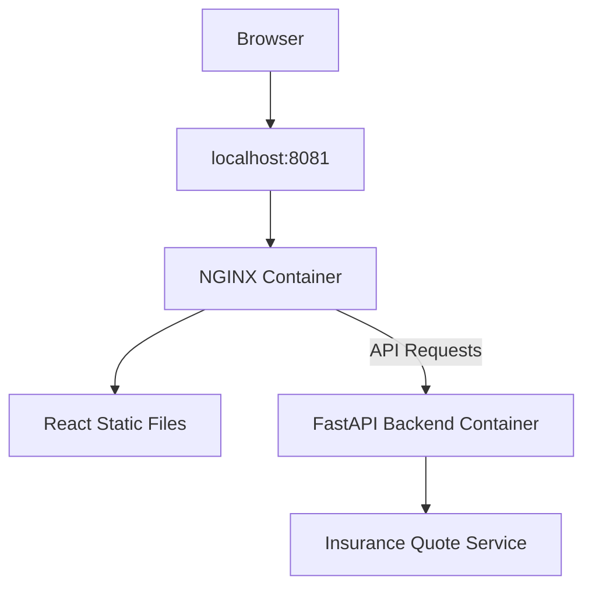
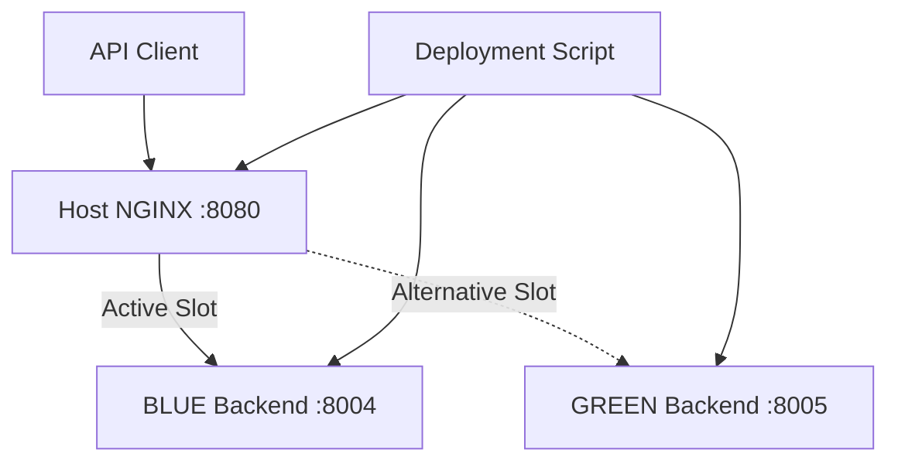
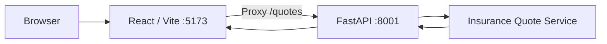

# AutoQuote — Full-Stack Insurance Comparison & DevOps CI/CD Platform

AutoQuote is a full-stack auto insurance comparison application built with **React, FastAPI, Docker, NGINX, and GitHub Actions**.

The application allows users to enter driver and vehicle information, select insurance coverage, and compare simulated premiums from three fictional insurance providers.

The project demonstrates a DevOps workflow covering application development, automated testing, containerization, vulnerability scanning, image publishing, CI/CD, Docker Compose, and Blue-Green backend deployment validation.

> **Disclaimer:** AutoQuote is a demonstration project. All insurance providers and premiums are simulated. The application does not retrieve real insurance quotes or issue insurance policies.

---

## 1. Project Overview

### Application Features

- Responsive React insurance comparison interface.
- FastAPI REST API.
- Driver and vehicle information validation.
- Simulated insurance premium calculations.
- Comparison of three fictional insurance providers.
- Monthly and annual premium display.
- Automatic highlighting of the lowest-priced provider.
- Backend health monitoring.

### DevOps Features

- Automated frontend linting and production builds.
- Automated Python dependency validation.
- Backend testing using Pytest.
- Docker containerization.
- Trivy container vulnerability scanning.
- Docker image publishing to GitHub Container Registry (GHCR).
- GitHub Actions CI/CD using GitHub-hosted runners.
- Automated Blue-Green backend deployment validation.
- Docker Compose full-stack integration testing.
- NGINX reverse proxy and frontend hosting.
- Automated health and end-to-end verification.

### Project Status

**Status: Implemented and Successfully Validated**

The application has been tested through GitHub Actions and local development.

| Component | Status |
|---|---|
| React frontend | Completed |
| FastAPI backend | Completed |
| Backend automated tests | Passed |
| Frontend lint and build | Passed |
| Docker image build | Passed |
| Trivy security scan | Passed |
| GHCR image publishing | Passed |
| Blue-Green deployment validation | Passed |
| Docker Compose integration validation | Passed |
| End-to-end verification | Passed |
| Local browser testing | Passed |

### Validated GitHub Actions Execution

- **Workflow run:** #18
- **Commit:** `4b9dd87`
- **Result:** All eight jobs passed
- **Execution time:** Approximately 3 minutes 19 seconds
- **Runner:** GitHub-hosted Ubuntu

Workflow execution:

https://github.com/imtiaz04/autoquote-platform/actions/runs/41474182757

> **Important:** GitHub Actions validates the deployment architecture using temporary GitHub-hosted runners. It does not deploy the application persistently to the developer's Ubuntu laptop.

---

## 2. Technology Stack

| Category | Technology | Purpose |
|---|---|---|
| Frontend | React 19 | User interface |
| Frontend Build Tool | Vite 8 | Development server and production builds |
| Frontend Language | JavaScript | Application logic |
| Frontend Code Quality | ESLint | Static code analysis |
| Backend Language | Python 3.12 | Backend development |
| Backend Framework | FastAPI | REST API |
| Data Validation | Pydantic | Request validation |
| Backend Testing | Pytest | Automated tests |
| Containerization | Docker | Application packaging |
| Container Orchestration | Docker Compose | Local full-stack deployment |
| CI/CD | GitHub Actions | Automated validation and image publishing |
| CI/CD Runner | GitHub-hosted Ubuntu | Workflow execution |
| Security | Trivy | Container vulnerability scanning |
| Container Registry | GHCR | Docker image storage |
| Web Server | NGINX | Frontend hosting and reverse proxy |
| Deployment Strategy | Blue-Green | Backend release switching and validation |
| Automation | Bash | Deployment scripting |
| Version Control | Git and GitHub | Source code management |

---

## 3. Application Architecture

AutoQuote consists of three main application components:

1. React frontend.
2. FastAPI backend.
3. NGINX reverse proxy.

The application can be run using local development servers or Docker Compose.

### Docker Compose Architecture



### Application Request Flow

1. The user opens AutoQuote in a browser.
2. NGINX serves the React frontend.
3. The user enters driver, vehicle, and coverage information.
4. React sends an API request to `/quotes/compare`.
5. NGINX forwards the request to FastAPI.
6. Pydantic validates the submitted information.
7. The backend calculates simulated insurance premiums.
8. Three quotes are returned in ascending price order.
9. React displays monthly and annual premiums.

### Application URL

When Docker Compose is running:

```text
http://127.0.0.1:8081/
```

The application is available locally on port `8081`.

The local Blue-Green demonstration uses a separate NGINX configuration on port `8080` and exposes the backend API rather than the complete React application.

---

## 4. CI/CD Pipeline

AutoQuote uses GitHub Actions to automate frontend and backend validation, Docker image building, vulnerability scanning, image publishing, and deployment verification.

Workflow file:

```text
.github/workflows/backend-ci.yml
```

### CI/CD Architecture



### GitHub Actions Jobs

The workflow contains eight jobs.

| Job | Responsibility |
|---|---|
| 1. Frontend — Lint and Production Build | Install frontend dependencies, run ESLint, and build React |
| 2. Validate Dependencies | Install and validate Python dependencies |
| 3. Run Automated Tests | Execute backend tests using Pytest |
| 4. Build Docker Image | Build the backend Docker image |
| 5. Trivy Security Scan | Scan the Docker image for vulnerabilities |
| 6. Publish Docker Image to GHCR | Publish the validated backend image |
| 7. Blue-Green Deployment Validation | Validate backend deployment and traffic switching |
| 8. Docker Compose and End-to-End Verification | Validate the complete containerized application |

### Workflow Triggers

The workflow runs on:

- Pushes to `main`.
- Pull requests targeting `main`.
- Manual execution using `workflow_dispatch`.

### Pull Request Execution

For pull requests, the workflow runs the first five jobs:

1. Frontend lint and production build.
2. Dependency validation.
3. Automated backend tests.
4. Docker image build.
5. Trivy security scan.

Publishing and deployment validation jobs are not executed for pull requests.

### Main Branch Execution

On pushes to `main`, all eight jobs execute.

The workflow validates the application before publishing the backend Docker image to GHCR.

### Frontend CI

The frontend job executes:

```bash
npm ci
npm run lint
npm run build
```

The production build is generated in:

```text
frontend/dist/
```

### Backend CI

The backend pipeline performs:

1. Dependency validation.
2. Automated testing.
3. Docker image building.
4. Trivy vulnerability scanning.
5. Docker image publication.

Docker images are published using the Git commit SHA:

```text
ghcr.io/imtiaz04/autoquote-backend:<commit-sha>
```

### Blue-Green Deployment Validation

The Blue-Green validation job runs on a temporary GitHub-hosted Ubuntu runner.

It validates the backend deployment process, including container startup, health checks, and NGINX traffic switching.

The deployment validation uses the published backend Docker image.

This job demonstrates that the Blue-Green deployment mechanism works in the CI environment.

**It does not update the running application on the developer's laptop.**

### Docker Compose and End-to-End Verification

The final job validates the complete application using Docker Compose.

The verification covers:

- Backend container startup.
- Backend health checks.
- NGINX availability.
- React frontend availability.
- Communication between NGINX and FastAPI.
- Insurance comparison API functionality.

Temporary CI containers are discarded when the GitHub-hosted runner finishes.

### GitHub-Hosted Runner

All eight jobs use GitHub-hosted Ubuntu runners.

```yaml
runs-on: ubuntu-latest
```

GitHub provisions temporary runner environments for workflow execution.

Advantages for this project include:

- No self-hosted runner installation.
- No runner maintenance.
- Clean execution environments.
- Reproducible pipeline execution.
- No dependency on the developer's laptop being online.

### CI/CD Limitation

The current workflow validates deployment but does not maintain a persistent production deployment.

A separate deployment target would be required for continuous hosting.

---

## 5. Deployment Architecture

AutoQuote supports two separate containerized deployment demonstrations.

### Deployment Options

| Deployment | Purpose | Port |
|---|---|---|
| Docker Compose | Complete React + FastAPI application | 8081 |
| Local Blue-Green | Backend deployment and NGINX traffic switching | 8080 |

These configurations are independent.

### A. Docker Compose Full-Stack Deployment

Docker Compose runs:

- FastAPI backend container.
- NGINX container serving the React production build.
- Internal Docker network connecting both services.

Architecture:



Docker Compose configuration:

```text
compose.yaml
```

NGINX configuration:

```text
nginx/compose.conf
```

### Docker Compose Port Configuration

| Component | Address / Port |
|---|---|
| Browser access | `127.0.0.1:8081` |
| NGINX container | `80` |
| FastAPI container | `8000` |
| Backend service name | `backend` |

The backend communicates with NGINX through Docker's internal network.

The backend does not require a separate public host port.

### NGINX Request Routing

The NGINX configuration uses three main routes:

| Route | Responsibility |
|---|---|
| `/` | Serve React production files |
| `/quotes/` | Forward insurance comparison requests to FastAPI |
| `/healthz` | Forward backend health checks |

The React application is served from:

```text
/usr/share/nginx/html
```

NGINX forwards API requests to:

```text
http://backend:8000
```

### B. Local Blue-Green Backend Deployment

The Blue-Green deployment demonstrates backend release switching.

Two Docker containers provide separate backend deployment slots.

| Slot | Container | Host Port |
|---|---|---|
| BLUE | `autoquote-blue` | 8004 |
| GREEN | `autoquote-green` | 8005 |

Host NGINX listens on:

```text
127.0.0.1:8080
```

Architecture:



Only the active backend slot receives traffic through NGINX.

The inactive slot can be used for a new release.

### Deployment Script

```text
scripts/deploy.sh
```

The deployment process:

1. Selects the target deployment slot.
2. Pulls the required Docker image.
3. Starts the replacement backend container.
4. Waits for the backend health check.
5. Updates NGINX routing.
6. Validates the NGINX configuration.
7. Reloads NGINX.
8. Verifies backend availability.

The script includes recovery logic for supported deployment failures.

### NGINX Configuration

The repository provides a reusable configuration template:

```text
nginx/autoquote.conf.example
```

The local runtime configuration is:

```text
nginx/autoquote.conf
```

The runtime file is machine-specific and is excluded from Git tracking.

This prevents local Blue-Green slot changes from creating unnecessary Git modifications.

### Important Architecture Distinction

The Docker Compose deployment on port `8081` serves the complete application.

The local Blue-Green deployment on port `8080` demonstrates backend traffic switching.

The Blue-Green NGINX configuration does not serve the React frontend.

---

## 6. Repository Structure

```text
autoquote-platform/
│
├── .github/
│   └── workflows/
│       └── backend-ci.yml
│
├── frontend/
│   ├── public/
│   ├── src/
│   │   ├── App.jsx
│   │   ├── App.css
│   │   ├── index.css
│   │   └── main.jsx
│   ├── Dockerfile
│   ├── package.json
│   ├── package-lock.json
│   └── vite.config.js
│
├── backend/
│   ├── app/
│   │   ├── main.py
│   │   ├── models/
│   │   ├── routes/
│   │   └── services/
│   ├── tests/
│   │   └── test_quotes.py
│   ├── Dockerfile
│   ├── requirements.txt
│   └── requirements-dev.txt
│
├── nginx/
│   ├── autoquote.conf.example
│   └── compose.conf
│
├── scripts/
│   └── deploy.sh
│
├── compose.yaml
├── .gitignore
└── README.md
```

The local runtime file `nginx/autoquote.conf` is intentionally excluded from Git tracking.

---

## 7. Getting Started — Clone and Run AutoQuote Locally

This section explains how a new developer can clone and run AutoQuote on Ubuntu.

There are two supported approaches:

- **Option A:** Local development using React/Vite and FastAPI.
- **Option B:** Full-stack deployment using Docker Compose.

### Local Development Ports

| Component | Port |
|---|---|
| React / Vite frontend | 5173 |
| FastAPI backend | 8001 |
| Docker Compose application | 8081 |
| Local Blue-Green NGINX | 8080 |
| BLUE backend | 8004 |
| GREEN backend | 8005 |

Only ports `5173` and `8001` are required for local development without Docker.

### Step 1 — Install Prerequisites

For local development, install:

- Git.
- Python 3.12.
- Python virtual environment support.
- Node.js 22.
- npm.

Verify the required tools:

```bash
git --version
python3.12 --version
node --version
npm --version
```

For Docker Compose deployment, install Docker Engine with Docker Compose support.

Verify Docker:

```bash
docker --version
docker compose version
```

### Step 2 — Clone the Repository

```bash
git clone https://github.com/imtiaz04/autoquote-platform.git

cd autoquote-platform
```

All subsequent commands assume the repository root unless otherwise stated.

---

### Option A — Run Using React and FastAPI

#### Step 3 — Check Port Availability

```bash
sudo ss -ltnp '( sport = :8001 or sport = :5173 )'
```

If a port is occupied, identify the process before making changes.

Do not stop unrelated applications or Docker containers.

#### Step 4 — Create a Python Virtual Environment

```bash
python3.12 -m venv .venv
```

#### Step 5 — Install Backend Dependencies

```bash
./.venv/bin/python -m pip install -r backend/requirements-dev.txt
```

#### Step 6 — Install Frontend Dependencies

```bash
cd frontend
npm ci
cd ..
```

#### Step 7 — Start FastAPI

Open Terminal 1.

From the repository root:

```bash
./.venv/bin/python -m uvicorn app.main:app \
  --app-dir backend \
  --host 127.0.0.1 \
  --port 8001
```

Expected output includes:

```text
INFO: Application startup complete.
```

Keep Terminal 1 running.

#### Step 8 — Start React

Open Terminal 2.

Navigate to the frontend directory:

```bash
cd frontend
npm run dev
```

The development server normally starts at:

```text
http://localhost:5173/
```

Keep Terminal 2 running.

#### Step 9 — Open AutoQuote

Open:

```text
http://localhost:5173/
```

Enter driver and vehicle details, select a coverage type, and click **Compare Quotes**.

The application should display three simulated insurance quotes.

#### Step 10 — Verify Backend Health

Open another terminal:

```bash
curl http://127.0.0.1:8001/healthz
```

Expected response:

```json
{
  "status": "healthy"
}
```

#### Step 11 — Test the Insurance Comparison API

```bash
curl -X POST http://127.0.0.1:8001/quotes/compare \
  -H "Content-Type: application/json" \
  -d '{
    "driver_age": 25,
    "zip_code": "08830",
    "vehicle_year": 2022,
    "vehicle_make": "Toyota",
    "vehicle_model": "Camry",
    "coverage_type": "full"
  }'
```

The API should return three simulated insurance quotes.

### Local Development Architecture



### Vite API Proxy Configuration

The development proxy is configured in:

```text
frontend/vite.config.js
```

The `/quotes` proxy target should point to:

```text
http://127.0.0.1:8001
```

This allows React and FastAPI to communicate locally without NGINX.

### Stopping Local Development

Press `Ctrl+C` in the React terminal.

Press `Ctrl+C` in the FastAPI terminal.

---

### Option B — Run the Complete Application with Docker Compose

This approach runs the frontend and backend as containers.

Docker Engine and Docker Compose are required.

#### Step 1 — Build and Start the Application

From the repository root:

```bash
docker compose up -d --build
```

Docker Compose builds and starts the application containers.

#### Step 2 — Check Container Status

```bash
docker compose ps
```

Verify that the backend and NGINX services are running.

#### Step 3 — Verify Backend Health

```bash
curl http://127.0.0.1:8081/healthz
```

Expected response:

```json
{
  "status": "healthy"
}
```

#### Step 4 — Open the Application

Open:

```text
http://127.0.0.1:8081/
```

The React insurance comparison interface should load.

Submit valid driver and vehicle information to verify the complete application.

#### Step 5 — View Container Logs

```bash
docker compose logs
```

#### Step 6 — Stop the Application

```bash
docker compose down
```

This stops and removes the Compose-managed containers and network.

It does not remove the Docker images or application source files.

---

## 8. Insurance Comparison API

### Available Endpoints

| Method | Endpoint | Description |
|---|---|---|
| GET | `/` | Application information |
| GET | `/healthz` | Backend health check |
| POST | `/quotes/compare` | Simulated insurance comparison |

### Example Request

```http
POST /quotes/compare
```

```json
{
  "driver_age": 25,
  "zip_code": "08830",
  "vehicle_year": 2022,
  "vehicle_make": "Toyota",
  "vehicle_model": "Camry",
  "coverage_type": "full"
}
```

### Example Response

```json
{
  "quote_type": "simulated",
  "currency": "USD",
  "quotes": [
    {
      "provider": "Demo Insurer C",
      "monthly_premium": 180.0,
      "annual_premium": 2160.0
    },
    {
      "provider": "Demo Insurer A",
      "monthly_premium": 200.0,
      "annual_premium": 2400.0
    },
    {
      "provider": "Demo Insurer B",
      "monthly_premium": 230.0,
      "annual_premium": 2760.0
    }
  ]
}
```

### Request Validation

The backend validates:

- Driver age.
- ZIP code.
- Vehicle year.
- Vehicle make.
- Vehicle model.
- Coverage type.

Supported coverage types:

```text
liability
full
```

Invalid requests return HTTP `422`.

All premiums use simulated pricing rules.

### Example Insurance Comparison

| Provider | Monthly Premium | Annual Premium |
|---|---:|---:|
| Demo Insurer C | $180 | $2,160 |
| Demo Insurer A | $200 | $2,400 |
| Demo Insurer B | $230 | $2,760 |

The lowest-priced provider is highlighted in the React interface.

---

## 9. Automated Testing

### Backend Tests

AutoQuote uses Pytest.

From the repository root:

```bash
./.venv/bin/python -m pytest -v backend/tests
```

The tests cover:

- Successful insurance quote generation.
- Request validation.
- Premium calculations.
- Quote ordering.
- Invalid input handling.

### Frontend Validation

From the repository root:

```bash
cd frontend

npm ci

npm run lint

npm run build
```

The production build is generated in:

```text
frontend/dist/
```

### CI/CD Testing

The GitHub Actions workflow automatically executes the relevant validation jobs when code is pushed or a pull request is opened.

A successful pipeline confirms that the configured checks passed for that commit.

---

## 10. Run the Backend with Docker

Docker can run the FastAPI backend independently.

This is useful for testing the backend container without starting the complete application.

### Build the Docker Image

From the repository root:

```bash
docker build -t autoquote-backend:local ./backend
```

### Start the Container

```bash
docker run --rm \
  --name autoquote-local \
  -p 127.0.0.1:8001:8000 \
  autoquote-backend:local
```

Port mapping:

| Location | Port |
|---|---|
| Host | 8001 |
| Container | 8000 |

**Important:** Stop any locally running FastAPI process on port `8001` before starting this container.

### Verify the Docker Container

```bash
curl http://127.0.0.1:8001/healthz
```

Expected response:

```json
{
  "status": "healthy"
}
```

---

## 11. Reproducing the CI/CD Workflow

The GitHub Actions workflow uses GitHub-hosted Ubuntu runners.

A self-hosted runner is not required.

### Prerequisites

To reproduce the CI/CD workflow in your own repository:

- A GitHub account.
- A GitHub repository containing the AutoQuote project.
- GitHub Actions enabled.
- Appropriate repository permissions for workflow execution.
- GitHub Container Registry access for image publishing.

### GitHub Actions Workflow

Workflow file:

```text
.github/workflows/backend-ci.yml
```

All jobs execute on:

```yaml
runs-on: ubuntu-latest
```

### Workflow Execution

The workflow supports:

- Push to `main`.
- Pull request to `main`.
- Manual workflow dispatch.

### Reproducing the Pipeline

1. Fork or clone the repository.
2. Configure the workflow for your repository and container registry.
3. Ensure GitHub Actions is enabled.
4. Push changes to `main` or trigger the workflow manually.
5. Open the GitHub Actions tab.
6. Review the eight workflow jobs.
7. Inspect logs and verification results.

### GHCR Image Publishing

The workflow publishes the backend Docker image to GitHub Container Registry.

Image naming convention:

```text
ghcr.io/imtiaz04/autoquote-backend:<commit-sha>
```

If using a fork, update repository-specific image references and permissions as required.

### Deployment Validation

The Blue-Green and Docker Compose verification jobs run on temporary GitHub-hosted runners.

They validate the deployment architecture without requiring a persistent deployment server.

### Persistent Deployment

The current workflow does not automatically deploy to the developer's Ubuntu laptop.

To maintain a continuously available application, a separate persistent deployment environment would be required.

That is outside the current project scope.

---

## 12. Deployment Verification

AutoQuote provides separate verification methods for Docker Compose and local Blue-Green deployment.

### A. Verify Docker Compose

#### Verify Containers

```bash
docker compose ps
```

#### Verify Backend Health

```bash
curl -i http://127.0.0.1:8081/healthz
```

Expected response includes:

```text
HTTP/1.1 200 OK
```

Expected response body:

```json
{
  "status": "healthy"
}
```

#### Verify React Frontend

Open:

```text
http://127.0.0.1:8081/
```

Confirm that the React insurance comparison interface loads.

#### Verify Insurance Comparison

Submit valid driver and vehicle information.

Confirm that:

1. The API request completes.
2. Three simulated insurance providers appear.
3. Monthly and annual premiums are displayed.
4. The lowest-priced provider is highlighted.

### B. Verify Local Blue-Green Backend

This section applies only when the separate local Blue-Green environment has been configured.

#### Verify NGINX Routing

```bash
curl -i http://127.0.0.1:8080/healthz
```

Expected response includes:

```text
HTTP/1.1 200 OK
X-Active-Slot: blue
```

The active slot may be `blue` or `green`.

#### Verify Backend Containers

```bash
docker ps \
  --filter "name=autoquote-blue" \
  --filter "name=autoquote-green" \
  --format "table {{.Names}}\t{{.Status}}\t{{.Ports}}"
```

Verify that the expected backend containers are running and healthy.

### C. Verify GitHub Actions

Open the GitHub Actions workflow execution.

Confirm that:

- Frontend validation passed.
- Backend dependency validation passed.
- Automated tests passed.
- Docker image build passed.
- Trivy scan passed.
- GHCR publishing passed.
- Blue-Green deployment validation passed.
- Docker Compose and end-to-end verification passed.

The deployment verification jobs run on GitHub-hosted infrastructure and do not modify the local Ubuntu deployment.

---

## 13. Troubleshooting

### Port Already in Use

Check the required local development ports:

```bash
sudo ss -ltnp '( sport = :8001 or sport = :5173 )'
```

For Docker Compose, check port `8081`:

```bash
sudo ss -ltnp '( sport = :8081 )'
```

Identify the process using the occupied port before making changes.

Do not stop unrelated applications.

### FastAPI Does Not Start

Verify the Python environment:

```bash
./.venv/bin/python --version
```

If `.venv` does not exist:

```bash
python3.12 -m venv .venv
```

Install dependencies:

```bash
./.venv/bin/python -m pip install -r backend/requirements-dev.txt
```

### React Does Not Start

Verify Node.js and npm:

```bash
node --version
npm --version
```

Install frontend dependencies:

```bash
cd frontend
npm ci
```

Start React:

```bash
npm run dev
```

### React Loads but Insurance Quotes Fail

Check that FastAPI is running:

```bash
curl http://127.0.0.1:8001/healthz
```

Verify the Vite proxy target in:

```text
frontend/vite.config.js
```

The target should match the FastAPI development port:

```text
http://127.0.0.1:8001
```

Restart the Vite development server after changing its configuration.

### Docker Compose Application Does Not Start

Check the containers:

```bash
docker compose ps
```

Review the logs:

```bash
docker compose logs
```

Verify that port `8081` is available.

### Docker Compose Frontend Loads but API Fails

Check backend health:

```bash
curl http://127.0.0.1:8081/healthz
```

Review the backend logs:

```bash
docker compose logs backend
```

Review the NGINX logs:

```bash
docker compose logs nginx
```

Verify the NGINX routing configuration:

```text
nginx/compose.conf
```

### HTTP 422 Error

HTTP `422` indicates that the submitted request failed validation.

Verify the required fields and supported coverage types.

### GitHub Actions Workflow Fails

Open the failed workflow execution in GitHub Actions.

Check:

- The failed job and step.
- Python dependency installation.
- Pytest results.
- Frontend lint or build errors.
- Docker image build errors.
- Trivy security scan findings.
- GHCR publishing permissions.
- Blue-Green validation logs.
- Docker Compose integration test logs.

The workflow uses GitHub-hosted runners.

Self-hosted runner registration and labels are not required.

### Local Blue-Green NGINX Fails

Verify the local NGINX configuration.

Check that the active backend container is running and healthy.

Review the configured upstream port.

The local runtime configuration is machine-specific and should not be committed to Git.

---

## 14. Security Practices

### Container Vulnerability Scanning

Trivy scans backend Docker images before publication.

The configured policy checks HIGH and CRITICAL severity vulnerabilities while ignoring unfixed findings.

Passing the scan means the image meets the configured policy, not that it is guaranteed vulnerability-free.

### Non-Root Backend Container

The backend Docker image is configured to execute the application using a non-root user.

### GitHub Actions Permissions

Workflow permissions are configured for the required repository and container registry operations.

### Deployment Health Checks

The Blue-Green deployment process validates backend health before switching traffic.

Docker Compose verification also checks backend availability.

### Configuration and Credentials

Environment-specific configuration should be reviewed before deployment.

Credentials, tokens, and other secrets must not be committed to Git.

### Local NGINX Runtime Configuration

The local Blue-Green NGINX runtime configuration is excluded from Git tracking.

The repository provides a reusable example configuration instead.

---

## 15. Current Limitations

AutoQuote is a demonstration and DevOps portfolio project.

Current limitations include:

- Insurance providers and premiums are simulated.
- No integration with real insurance company APIs.
- No persistent insurance quote database.
- No user authentication.
- Simplified premium calculation rules.
- GitHub Actions validates deployment but does not maintain a persistent production environment.
- Docker Compose is intended for local full-stack execution and validation.
- Local Blue-Green deployment applies to the backend only.
- The frontend does not use Blue-Green deployment.
- No automatic frontend rollback mechanism.
- Local Blue-Green deployment requires a separately configured Docker and NGINX environment.

These limitations define the current project scope.

---

## 16. Author

Developed as a hands-on **Full-Stack Application and DevOps Engineering Portfolio Project**.

GitHub: **imtiaz04**

Repository:

https://github.com/imtiaz04/autoquote-platform

---

## 17. License

No license has been selected for this repository.

Until a license is added, the repository should not be assumed to grant permission for unrestricted redistribution or modification.

---

**AutoQuote demonstrates full-stack application development integrated with automated testing, Docker, container security scanning, GitHub Actions CI/CD, NGINX, Docker Compose, and Blue-Green backend deployment validation.**